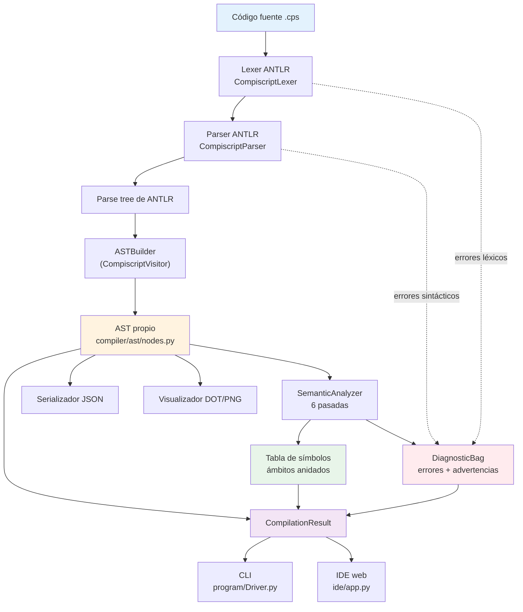
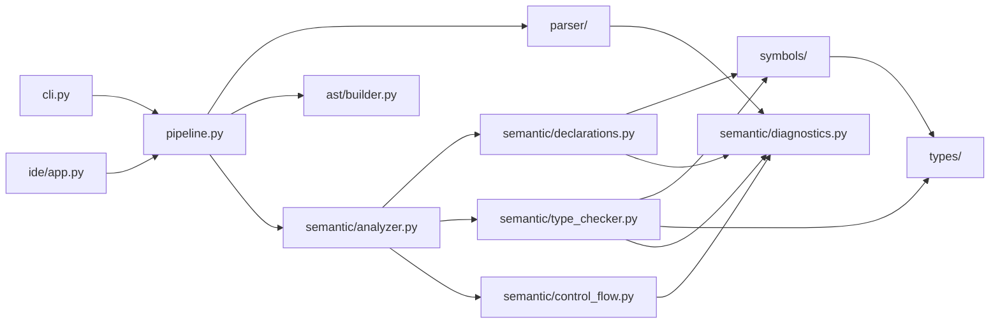
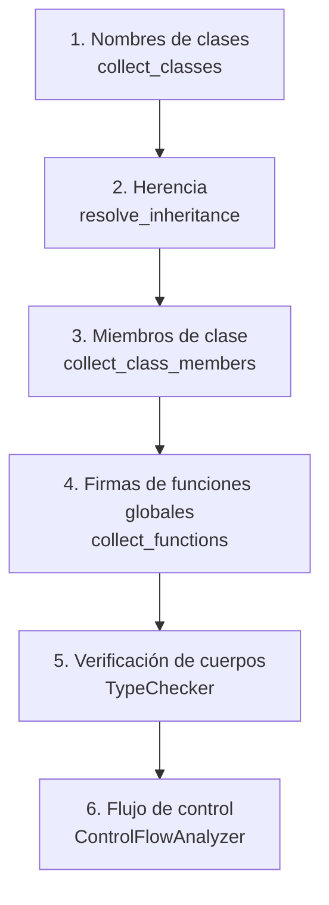
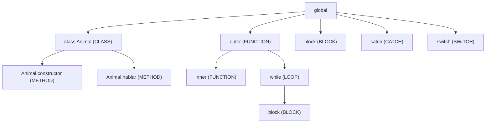

# Arquitectura del compilador de Compiscript

Este documento describe el flujo completo de compilación, la organización de los
módulos y las decisiones estructurales de la fase de análisis semántico.

---

## 1. Flujo de compilación

La "compilación" en esta fase consiste en seis pasos. No se genera código
máquina; el resultado es un diagnóstico, un AST tipado y una tabla de símbolos.



### Pasos

1. **Lectura del código fuente.** `compile_source(source, filename)` recibe el
   texto; `compile_file(path)` lo lee del disco.
2. **Análisis léxico y sintáctico.** ANTLR produce el parse tree. Los listeners
   por defecto se eliminan y se sustituyen por `CollectingErrorListener`, que
   traduce cada error a un `Diagnostic` con archivo, línea y columna.
3. **Construcción del AST.** Si (y solo si) no hubo errores sintácticos, el
   `ASTBuilder` convierte el parse tree en el AST propio. Es la única frontera
   con ANTLR: ningún módulo posterior toca contextos de ANTLR.
4. **Tabla de símbolos y análisis semántico.** El `SemanticAnalyzer` ejecuta seis
   pasadas sobre el AST, construyendo los ámbitos y acumulando diagnósticos.
5. **Análisis de flujo de control.** Caminos de retorno y código inalcanzable.
6. **Presentación.** El `CompilationResult` se entrega al CLI (texto o JSON) o al
   IDE (JSON), y opcionalmente se exportan el AST (DOT/JSON/PNG) y la tabla de
   símbolos (JSON/texto).

> Si el parse tree no es confiable (hubo errores sintácticos), el análisis
> semántico **no** se ejecuta: reportarlo produciría errores en cascada sin
> valor para el usuario.

---

## 2. Relación entre parse tree y AST

El parse tree de ANTLR refleja la gramática, no el programa: contiene un nodo
por cada regla intermedia de precedencia (`logicalOrExpr`, `logicalAndExpr`,
`equalityExpr`, …) aunque no haya operador alguno. El AST propio elimina ese
ruido y añade lo que el análisis necesita.

| Aspecto | Parse tree de ANTLR | AST propio |
| --- | --- | --- |
| Origen | Generado, no editable | `compiler/ast/nodes.py` |
| Cadenas de precedencia | Un nodo por regla | Colapsadas a `BinaryExpr` |
| Ubicación | Tokens | `SourceSpan` (inicio y fin, 1-based) |
| Tipos | No los tiene | `resolved_type` en cada expresión |
| Símbolos | No los tiene | `resolved_symbol` en identificadores |
| Acoplamiento | Total con ANTLR | Ninguno |

Ejemplo: `1 + 2 * 3` produce en ANTLR una cadena de ~8 contextos anidados; en el
AST propio son 5 nodos (`BinaryExpr(+)` → `IntegerLiteral(1)`,
`BinaryExpr(*)` → `IntegerLiteral(2)`, `IntegerLiteral(3)`).

---

## 3. Organización de los módulos

```text
.
├── program/                    # Playground original del curso
│   ├── Compiscript.g4          # Gramática (extendida con float y void)
│   ├── Compiscript.bnf         # Versión BNF, sincronizada con la .g4
│   ├── Compiscript*.py         # GENERADOS por ANTLR — nunca se editan a mano
│   ├── Driver.py               # Punto de entrada tradicional (delega en el CLI)
│   └── program.cps             # Programa de ejemplo del curso
│
├── compiler/                   # Frontend (toda la lógica propia)
│   ├── pipeline.py             # compile_source / compile_file
│   ├── result.py               # CompilationResult, CompileOptions
│   ├── cli.py                  # Interfaz de línea de comandos
│   ├── parser/
│   │   ├── antlr_runtime.py    # Única importación de los archivos generados
│   │   └── error_listener.py   # ErrorListener propio (léxico y sintáctico)
│   ├── ast/
│   │   ├── nodes.py            # Nodos del AST (dataclasses) + SourceSpan
│   │   ├── builder.py          # Parse tree de ANTLR -> AST propio
│   │   ├── serializer.py       # AST -> dict / JSON / texto
│   │   └── visualizer.py       # AST -> Graphviz DOT -> PNG/SVG
│   │                           # (Node.to_tree() da la versión en texto)
│   ├── types/
│   │   ├── types.py            # Type, PrimitiveType, ArrayType, ClassType…
│   │   └── compatibility.py    # is_assignable, is_comparable, common_type…
│   ├── symbols/
│   │   ├── symbols.py          # Symbol, VariableSymbol, FunctionSymbol, ClassSymbol
│   │   ├── scope.py            # Scope y ScopeKind
│   │   └── table.py            # SymbolTable + ClassRegistry + exportación
│   │                           # (to_tree / to_text / to_dict)
│   └── semantic/
│       ├── analyzer.py         # Orquestador de las pasadas
│       ├── declarations.py     # Pasadas 1-4 (clases, herencia, miembros, firmas)
│       ├── type_resolver.py    # TypeRef sintáctico -> Type
│       ├── type_checker.py     # Pasada 5 (ámbitos, tipos, reglas)
│       ├── control_flow.py     # Pasada 6 (retornos y código muerto)
│       └── diagnostics.py      # Diagnostic, DiagnosticBag, catálogo de códigos
│
├── ide/                        # IDE web (capa delgada sobre compile_source)
├── tests/                      # Batería de pruebas (12 archivos)
├── examples/                   # Programas .cps: valid/ e invalid/
├── scripts/generate_parser.sh  # Regeneración reproducible del parser
└── docs/                       # Esta documentación
```

### Dirección de las dependencias



Reglas que se respetan:

- `types/` no depende de nada del compilador (es la capa más baja).
- `symbols/` depende solo de `types/` y de `ast/nodes.py` (para `SourceSpan`).
- `semantic/` depende de `ast/`, `symbols/` y `types/`.
- **Ningún** módulo de análisis imprime: todo pasa por `DiagnosticBag`.
- El CLI y el IDE consumen el mismo `CompilationResult`.

---

## 4. Estrategia de pasadas

Un único recorrido lineal no permitiría recursión, recursión mutua ni usar una
clase antes de su declaración textual. Por eso el análisis se divide en pasadas:



| Pasada | Qué registra | Qué habilita |
| --- | --- | --- |
| 1 | Nombre y símbolo de cada clase | Usar `C` como tipo antes de declararla |
| 2 | Clase base; detección de ciclos | Herencia y búsqueda de miembros heredados |
| 3 | Atributos, métodos y constructor | Resolución de `obj.m()` y `this.a` |
| 4 | Firmas de funciones globales | Recursión y recursión mutua |
| 5 | Ámbitos, tipos y reglas semánticas | El grueso del análisis |
| 6 | Terminación de cada sentencia | `SEM025` y advertencias de código muerto |

### Diferimiento de cuerpos

Dentro de la pasada 5, al recorrer una lista de sentencias:

1. Se **hoistean** las funciones declaradas en ese nivel (registro de firmas).
2. Se procesan las sentencias **no** declarativas en orden.
3. Al final, se analizan los **cuerpos** de las funciones y clases de ese nivel.

Esto permite que el cuerpo de una función vea todas las declaraciones hermanas
(incluidas las posteriores) sin renunciar a detectar el uso de una variable
antes de declararla en código lineal.

---

## 5. Tabla de símbolos y resolución de ámbitos

La tabla es un **árbol de ámbitos** más una pila que marca el ámbito actual.



Tipos de ámbito: `GLOBAL`, `FUNCTION`, `CLASS`, `METHOD`, `BLOCK`, `LOOP`,
`CATCH`, `SWITCH`.

Categorías de símbolo: `VARIABLE`, `CONSTANT`, `PARAMETER`, `FUNCTION`, `CLASS`,
`FIELD`, `METHOD`, `CONSTRUCTOR`.

**Resolución de nombres.** `Scope.resolve(name)` busca en el ámbito local y sube
por los padres hasta el global. `declare()` devuelve `False` si el nombre ya
existe **en el mismo ámbito** (redeclaración prohibida), pero permite el
sombreado entre ámbitos distintos.

**Closures.** Al resolver un identificador se compara el ámbito de función que
contiene la declaración con el de la función actual. Si difieren y el símbolo no
es global, se registra en `FunctionSymbol.captures` y se marca
`VariableSymbol.captured = True`.

**Información para fases futuras.** Cada símbolo guarda tipo, categoría,
ubicación, mutabilidad, estado de inicialización, tipo de retorno, parámetros
ordenados, clase propietaria, visibilidad, herencia, nodo del AST y un campo
`offset` reservado para la asignación de memoria.

---

## 6. Sistema de tipos

Los tipos son objetos inmutables comparables por valor, nunca cadenas sueltas:

- `PrimitiveType`: `integer`, `float`, `string`, `boolean`, `void`, `null`, más
  los internos `unknown` y `error`.
- `ArrayType(element)`: estructurado y anidable (`integer[][]` es
  `ArrayType(ArrayType(integer))`), con `dimensions` y `base_element`.
- `ClassType(class_name)`: nominal.
- `FunctionType(parameters, return_type)`: firma de una función o método.

Toda la compatibilidad vive en `compiler/types/compatibility.py`:
`is_assignable`, `is_numeric`, `is_boolean`, `is_reference`, `is_comparable`,
`common_numeric_type`, `common_type`, `common_array_element_type`,
`result_of_additive`.

**Control de cascadas.** `error` es el tipo de algo ya reportado y `unknown` el
de algo aún sin resolver (elemento de `[]`). Ambos son compatibles con todo, de
modo que un solo error no genera una avalancha de diagnósticos derivados.

Las reglas concretas están en [semantic-rules.md](semantic-rules.md) y las
decisiones ante ambigüedades en [semantic-decisions.md](semantic-decisions.md).

---

## 7. Diagnósticos

`Diagnostic` es inmutable e incluye: código estable, severidad, mensaje,
archivo, línea, columna, fin de span, fase y —cuando aplica— tipo esperado y
tipo recibido.

```text
program.cps:9:14 [SEM012] Asignacion incompatible en 'x': se esperaba 'integer' y se recibio 'string'.
```

`DiagnosticBag` acumula (nunca se detiene en el primer error), deduplica
mensajes idénticos en la misma posición y ordena por línea/columna/código.
Las líneas y columnas son **1-based** (ANTLR entrega la columna 0-based; la
conversión se hace al construir el span).

---

## 8. IDE

`ide/app.py` es una aplicación Flask de dos endpoints sobre la API interna:

| Endpoint | Método | Descripción |
| --- | --- | --- |
| `/` | GET | Página del editor |
| `/api/example` | GET | Devuelve `program/program.cps` |
| `/api/compile` | POST | `{source, strict}` → `CompilationResult.to_dict()` |

El frontend (HTML + CSS + JS sin dependencias externas) muestra el editor con
numeración de líneas, el panel de diagnósticos (clicables, saltan a la posición),
el AST como árbol plegable con el tipo resuelto de cada nodo y la tabla de
símbolos.

Restricciones de seguridad:

- El único dato que acepta el servidor es el **código fuente**; no hay
  parámetros de ruta y no se lee ningún archivo indicado por el usuario.
- No se ejecuta ningún comando proporcionado por el usuario.
- El tamaño del código está limitado (`MAX_SOURCE_BYTES`).
- El compilador funciona sin el IDE; el IDE no contiene lógica semántica.
