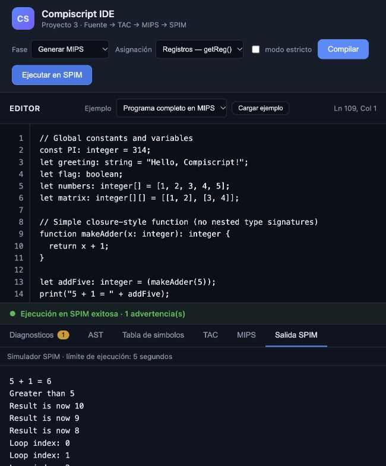

# Validación de la fase final

Revalidación de la entrega: **15 de noviembre de 2026** (America/Guatemala).

## Batería automatizada

Se descargó un clon limpio de `main` desde GitHub, en el commit
`d4a14f530c53f9e2bcaa1e475ff068627e2a206e`, y se extrajo el ZIP de la parte 2
en su raíz. Se instaló `requirements.txt` en un entorno virtual nuevo,
fuera de la carpeta de iCloud, y se ejecutó con SPIM disponible en PATH:

```text
python -m pytest tests -o addopts='' -q
488 passed in 4.07s
```

Se ejecutaron todas las pruebas, sin casos omitidos. El resultado incluye las
407 pruebas conservadas del frontend y 81 pruebas de la fase MIPS e IDE.
La generación de MIPS y su ejecución se verificaron tanto con registros como
con pila. El reporte JUnit está incluido en `docs/evidencias/pruebas.xml`.

Antes de integrar el ZIP también se comprobó el núcleo por separado: el
factorial produjo `120`, `720` y `5040` en SPIM, tanto con registros como con
pila. Los SHA-256 del clon y del ZIP coincidieron con el manifiesto.

Entorno utilizado: macOS, Python 3.13.0, runtime ANTLR 4.13.1, pytest 8.4.2,
Flask 3.1.3 y SPIM instalado en PATH. No se modificó la instalación global de
Python; la validación utilizó un entorno virtual separado.

## Recorrido comprobado en navegador

En la validación original del **11 de noviembre de 2026** se abrió el IDE
local y se comprobó:

- Factorial desde el editor hasta SPIM: `120`, `720`, `5040`.
- Constructor heredado y método sobrescrito en modo pila: `Toby ladra.`, `Toby`.
- `print(desconocido);`: SEM001 y descarga de assembler deshabilitada.
- `print(1 / 0);`: error del simulador presentado en la pestaña de salida.
- Programa completo del curso: ejecución hasta `Program finished.`, pasando
  por `catch`, método heredado, arreglos y control de flujo.
- Descarga real del `.asm` desde el botón del IDE.

La advertencia de índice fuera de rango del programa del curso es esperada:
el acceso está dentro de un `try` y se valida también en ejecución.



## Otras comprobaciones

- Sintaxis de JavaScript verificada con `node --check ide/static/app.js`.
- `git diff --check` sin errores de espacios.
- La imagen Docker incluye SPIM y las dependencias. En la validación original
  no se construyó porque el daemon de Docker del equipo estaba detenido.
  Tampoco se construyó durante esta revalidación. La validación
  de compilación, simulación e IDE se realizó de forma local.
- MARS no se ejecutó en esta validación; el simulador usado fue SPIM.

La integración de la parte 1 y el ZIP se comprueba también en una carpeta
limpia antes de publicar. Los archivos del paquete se identifican por SHA-256
en su manifiesto.
