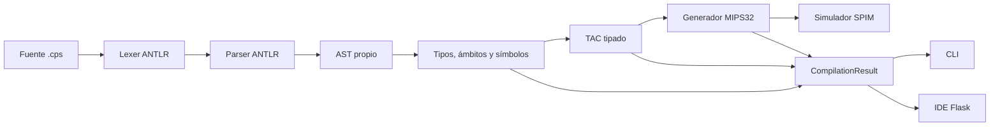

# Arquitectura de Compiscript

El compilador expone una API única para el CLI y el IDE. Su recorrido completo es:

Si hay errores léxicos o sintácticos, se detiene la construcción del AST.
Si falla la semántica, no se genera TAC ni MIPS. El modo estricto bloquea la
generación también ante advertencias. Los errores de backend tienen código
`GEN001`, fase `codegen` y posición del fuente cuando está disponible.

## Módulos y responsabilidades

| Módulo | Responsabilidad |
| --- | --- |
| `program/Compiscript.g4` | Gramática; conserva las extensiones float, void y const del frontend |
| `program/Compiscript*.py` | Lexer, parser y visitor generados por ANTLR 4.13.1 |
| `compiler/parser/` | Integración con ANTLR y listeners propios |
| `compiler/ast/` | AST independiente de ANTLR, posiciones, JSON y Graphviz |
| `compiler/types/` | Tipos explícitos y reglas de compatibilidad |
| `compiler/symbols/` | Símbolos, ámbitos, capturas, firmas y jerarquía de clases |
| `compiler/semantic/` | Declaraciones, tipos, retornos, control de flujo y diagnósticos |
| `compiler/ir/model.py` | Place, Constant, Instruction, IRFunction e IRProgram |
| `compiler/ir/generator.py` | AST validado → TAC; orden de evaluación, cortocircuito, capturas y clases |
| `compiler/backend/registers.py` | getReg, descriptores, siguiente uso y spill |
| `compiler/backend/mips.py` | TAC → MIPS, marcos, llamadas y retornos |
| `compiler/backend/runtime.py` | Strings, conversión de enteros, excepciones y mensajes |
| `compiler/backend/simulator.py` | Proceso externo de SPIM, timeout y detección de errores |
| `compiler/pipeline.py` | Orquestación de etapas y API compile_source/compile_file |
| `compiler/result.py` | Opciones y resultado compartido por CLI e IDE |
| `compiler/cli.py` | Exportaciones, diagnósticos y ejecución por terminal |
| `ide/` | Editor web, selección de ejemplos, resultados y descargas |

El backend recibe exclusivamente `IRProgram`; no depende del parse tree ni
vuelve a analizar la semántica. El IDE utiliza la misma API que el CLI.

## Frontend

El AST guarda tipos resueltos y referencias a los símbolos. Las ubicaciones
son de base 1. Los ámbitos forman un árbol con padre e hijos y permiten
sombreado entre bloques. La jerarquía de clases resuelve miembros heredados,
constructores y métodos sobrescritos.

El análisis registra primero clases, herencia, miembros y firmas; después
comprueba cuerpos y finalmente caminos de retorno y código inalcanzable.
Las funciones se declaran antes de analizar sus cuerpos para admitir
recursión mutua. Las reglas completas están en `semantic-rules.md` y las
decisiones de la fase anterior en `semantic-decisions.md`.

## Representación intermedia

`Place` identifica un hogar tipado y su función propietaria. Las instrucciones
conservan el span del fuente. `IRFunction` contiene parámetros, locales,
temporales, instrucciones y padre léxico; `IRProgram` incluye globales,
funciones y tablas de métodos virtuales.

Las lecturas de variables se congelan en temporales y los argumentos se
evalúan de izquierda a derecha. Los operadores `&&`, `||` y `?:` utilizan
saltos, evitando evaluar ramas innecesarias. `switch` conserva fall-through.
Los cuerpos de funciones y métodos se generan fuera del punto de entrada.

## Memoria, llamadas y registros

Cada invocación tiene su propio marco alineado a 8 bytes. `$fp` localiza hogares
aunque cambie `$sp`; se guardan `$ra`, `$fp` y los registros `$s` utilizados.
Los primeros cuatro argumentos ocupan `$a0-$a3` y los siguientes el área de
argumentos del llamador. El resultado vuelve en `$v0`, o `$f0` para float.

`getReg()` reutiliza registros o toma uno libre; si no puede, derrama el valor
cuyo siguiente uso está más lejos. Protege los operandos actuales y sincroniza
memoria en aristas de control, llamadas y operaciones que pueden fallar.
El modo `stack` sincroniza después de cada instrucción TAC. El algoritmo es
local y conservador; todos los valores tienen un hogar, incluso los temporales.

Una función anidada recibe un enlace al marco de su padre léxico, distinto del
llamador dinámico. Las capturas comparten ese hogar. Los objetos viven en heap:
primera palabra con vtable y luego atributos, conservando prefijos heredados.
`this` es un argumento oculto y `jalr` realiza el despacho dinámico.

Cada `try` instala un handler de 56 bytes en su marco. El runtime puede
restaurar la activación del handler aunque el error ocurra en otra función.
La salida normal y los saltos fuera del bloque retiran los handlers
correspondientes. No hay instrucción throw en la gramática.

Los detalles, registros utilizados y secuencias de instrucciones están en
`FASE3_MIPS.md`.

## IDE y ejecución

| Ruta | Método | Entrada / resultado |
| --- | --- | --- |
| `/` | GET | Editor, diagnósticos, AST, símbolos, TAC, MIPS y salida |
| `/api/example?name=factorial` | GET | Ejemplo de una lista permitida |
| `/api/compile` | POST | `{source, strict, generate_mips, allocation}` → resultado |
| `/api/run` | POST | Misma entrada; genera MIPS y ejecuta SPIM |

Las opciones booleanas y el modo de asignación se validan. El editor acepta
hasta 512 KiB y usa texto del fuente, sin rutas arbitrarias. SPIM se invoca
como proceso sin shell y con límite de 5 segundos desde el IDE (10 por defecto
en el CLI). El resultado distingue un error de compilación de un error de
simulación y conserva el assembler cuando falla la ejecución.

El frontend del IDE utiliza HTML, CSS y JavaScript locales. Las descargas
se crean a partir del resultado recibido. Cambiar fuente u opciones invalida
las salidas previas; una respuesta de una versión anterior del código no
reemplaza los resultados actuales.

## División de la entrega

La parte 1 del repositorio contiene los módulos `compiler/`, `program/`, los
seis ejemplos MIPS y el entorno. La parte 2 incorpora `ide/`, `tests/`, `docs/`,
ejemplos restantes, configuración de pytest y guía de integración. Las rutas
son complementarias y no es necesario reemplazar el núcleo al extraer el ZIP.
